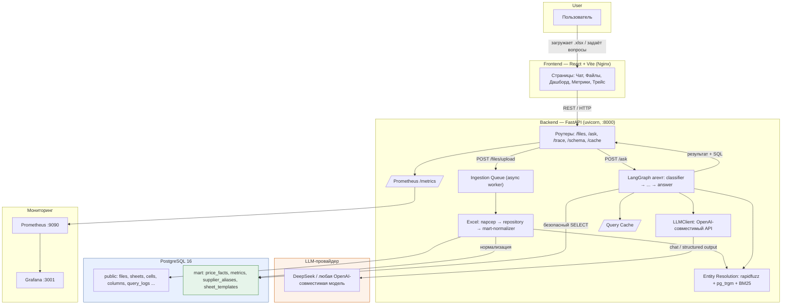
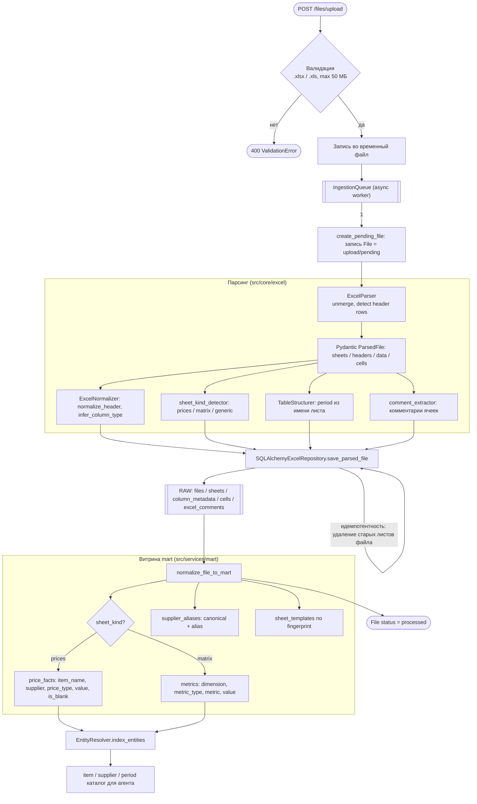
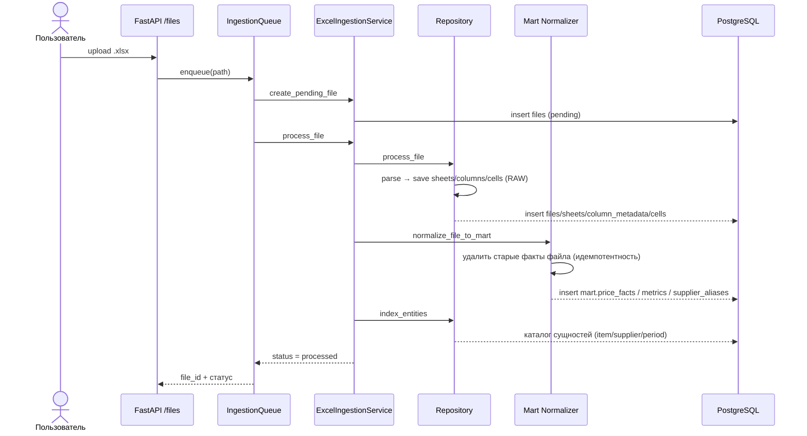
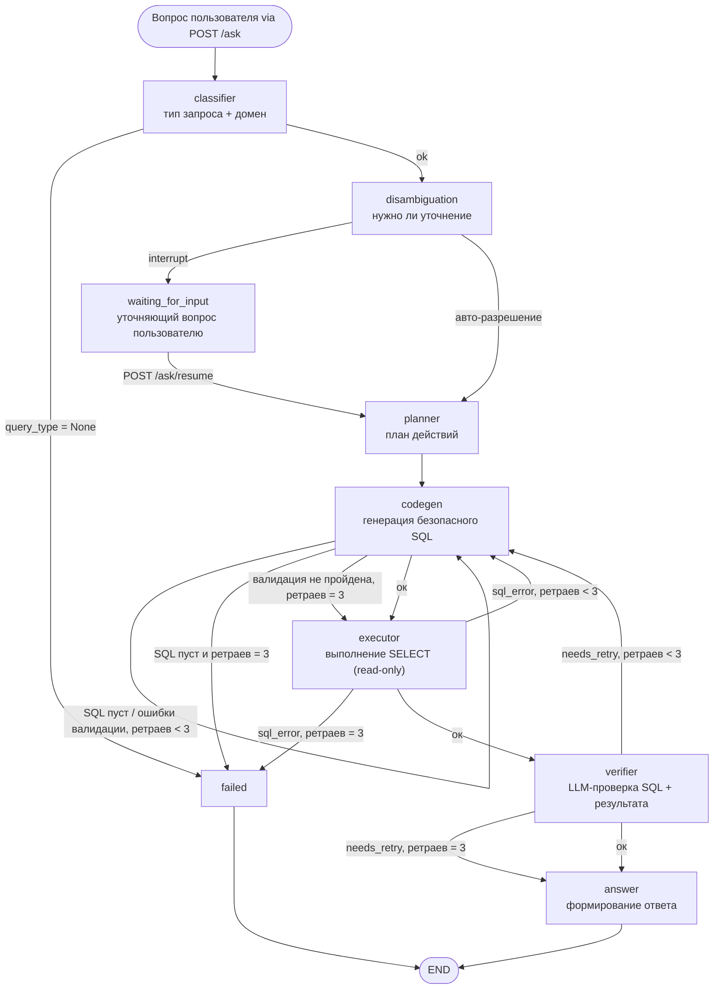
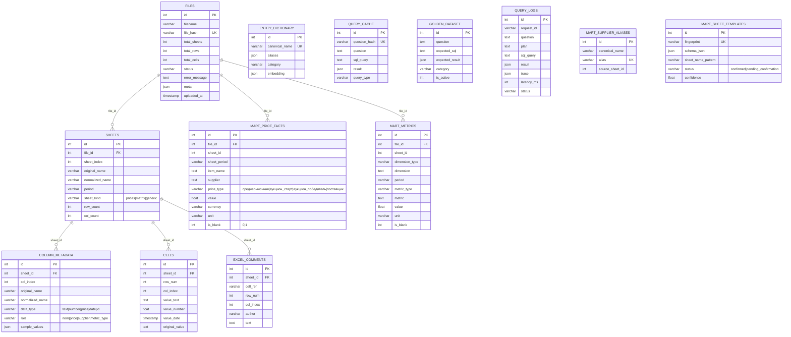
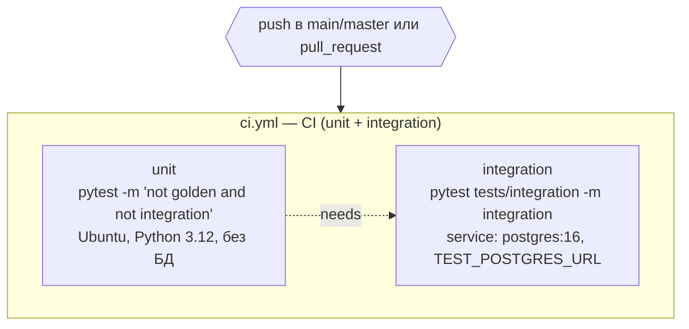

# EVRAZ Agent

**AI-агент для интеллектуальной работы с Excel-файлами металлургической компании ЕВРАЗ.**

     

Система позволяет загружать Excel-файлы с ценами на металлы, автоматически парсить и нормализовать их
в факт-таблицы витрины данных (`mart.price_facts`, `mart.metrics`) и отвечать на вопросы пользователя
на естественном языке через LangGraph-агент с безопасной генерацией и выполнением SQL в PostgreSQL.

Проект спроектирован как prod-ready: асинхронный ingestion файлов, entity-resolution по справочникам,
read-only генерация SQL, диалоговая память и уточняющие вопросы, построение графиков, наблюдаемость
(Prometheus/Grafana), auth и rate limiting, golden-датасет для регрессионного тестирования.

> **Документация проекта:**
> - [`PROJECT.md`](PROJECT.md) — подробное техническое описание;
> - [`INSTRUCTIONS.md`](INSTRUCTIONS.md) — инструкция по запуску (Docker / локально);
> - [`docs/PRESENTATION.md`](docs/PRESENTATION.md) — презентация проекта.

---

## Содержание

- [Возможности](#возможности)
- [Архитектура](#архитектура)
- [Стек технологий](#стек-технологий)
- [Быстрый старт](#быстрый-старт)
- [Конфигурация](#конфигурация)
- [API](#api)
- [Поток обработки файла](#поток-обработки-файла)
- [LLM-клиент и устойчивость](#llm-клиент-и-устойчивость)
- [Агент (LangGraph)](#агент-langgraph)
- [Диалоги, уточнения и графики](#диалоги-уточнения-и-графики)
- [Безопасность SQL](#безопасность-sql)
- [База данных](#база-данных)
- [Entity Resolution](#entity-resolution)
- [Наблюдаемость](#наблюдаемость)
- [Auth и rate limiting](#auth-и-rate-limiting)
- [Schema Inference](#schema-inference)
- [Golden dataset](#golden-dataset)
- [Бенчмарк](#бенчмарк)
- [Тесты](#тесты)
- [Диаграммы](#диаграммы)
- [Секреты](#секреты)
- [Структура проекта](#структура-проекта)
- [Документация](#документация)
- [Лицензия](#лицензия)

---

## Возможности

- **Загрузка Excel** (`.xlsx` / `.xls`, до 50 МБ) с асинхронной фоновой обработкой и опросом статуса.
- **Нормализация в витрину** `mart.price_facts` (цены лома) и `mart.metrics` (производственные метрики),
  идемпотентная — повторная заливка файла не дублирует факты.
- **LangGraph-агент**: Classifier → Disambiguation → Planner → CodeGen → Executor → Verifier → Answer,
  с чекпоинтами в PostgreSQL и ретраями на каждом узле.
- **Безопасная генерация SQL**: whitelist таблиц/колонок, keyword-blacklist, баланс скобок и кавычек,
  read-only выполнение с `statement_timeout`.
- **Entity-resolution** по справочникам (item_name / supplier / sheet_period) с fuzzy-поиском (rapidfuzz + pg_trgm).
- **Диалоговая память** — `conversation_id` / `thread_id` сохраняют контекст между вопросами.
- **Уточняющие вопросы** — при неоднозначности граф приостанавливается (`waiting_for_input`),
  пользователь отвечает через `POST /ask/resume`.
- **Графики** — ответ-временной ряд сразу содержит `chart_data`; кнопка «Сделай график» строит
  timeseries через `POST /ask/chart` без повторного вызова LLM.
- **Режимы ответа** — `detailed` (полный) и `concise` (только число/слово).
- **Кэш запросов** (`query_cache`): нормализованный вопрос → SQL → результат.
- **Schema Inference** (LLM) + Template Fingerprint для разнородных форматов таблиц.
- **API-key auth** + **rate limiting** (slowapi).
- **Prometheus-метрики** `/metrics` + JSON-сводка `/metrics/summary` (токены и стоимость LLM),
  расширенный журнал `query_logs` (трейсы узлов графа).
- **Golden dataset** (pytest, marker `golden`) и **бенчмарк** запросов для контроля качества.

---

## Архитектура



> Источник: [`diagrams/architecture.mmd`](diagrams/architecture.mmd).

Ключевые принципы:

- **Нормализованная long-факт-таблица** — агент генерирует простой SQL поверх `mart.price_facts` / `mart.metrics`,
  без обращения к сырым ячейкам и без тяжёлых векторных поисков в рантайме.
- **Детерминированные правки SQL** в `codegen_node` повышают надёжность LLM-генерации
  (префиксный поиск «все виды меди», нормализация дефисов поставщиков, приведение `is_blank` к 0/1).
- **Кэш ответов** и **fallback-логика** верификатора уменьшают количество повторных прогонов графа.

---

## Стек технологий

### Backend (Python ≥ 3.12)

- **FastAPI** + **uvicorn** — веб-фреймворк и ASGI-сервер.
- **LangGraph** + **langgraph-checkpoint-postgres** — явный StateGraph агента с чекпоинтами в Postgres.
- **langchain-openai** — структурированный (Pydantic) вывод LLM.
- **openai** — клиент OpenAI-совместимого API.
- **PostgreSQL** + **SQLAlchemy 2.0** (async, asyncpg) + **Alembic**.
- **openpyxl**, **pandas** — чтение и обработка Excel.
- **rapidfuzz** — нечёткое сопоставление сущностей.
- **loguru**, **prometheus-client**, **slowapi**, **pydantic-settings**, **python-multipart**.
- **pytest** — тесты.

Полный список зависимостей — в [`pyproject.toml`](pyproject.toml).

### Frontend (React)

- **React 18** + **TypeScript** + **Vite**.
- **react-router-dom**, **chart.js**, **framer-motion**, **lucide-react**, **react-markdown**.

Полный список — в [`frontend/package.json`](frontend/package.json).

### Инфраструктура (Docker Compose)

| Сервис | Порт | Назначение |
|---|---|---|
| `postgres` | 5432 | PostgreSQL 16 (+ `pg_trgm`) |
| `service` (backend) | 8000 | FastAPI-приложение |
| `frontend` | 8080/80 | React (Nginx) |
| `prometheus` | 9090 | сбор метрик |
| `grafana` | 3001 | дашборды (admin/admin) |

---

## Быстрый старт

```bash
cp .env.example .env
# заполните .env (LLM_BASE_URL / LLM_API_KEY / LLM_MODEL_PRIMARY и POSTGRES_*)

docker compose up --build
# применить миграции БД:
docker compose exec service alembic upgrade head
```

- Backend (Swagger): http://localhost:8000/docs
- Frontend: http://localhost:8080
- Prometheus: http://localhost:9090
- Grafana: http://localhost:3001 (admin/admin)

После запуска загрузите Excel-файл через страницу **«Файлы»** — система распарсит и нормализует его,
после чего можно задавать вопросы в **«Чате»**.

> Подробная инструкция по запуску (Docker Compose, локальная разработка, миграции, устранение
> неполадок) — в [`INSTRUCTIONS.md`](INSTRUCTIONS.md).

---

## Конфигурация

Конфигурация читается из `.env` через `pydantic-settings` (см. [`src/core/config.py`](src/core/config.py)).
Полный шаблон — в [`.env.example`](.env.example).

| Переменная | Описание | По умолчанию |
|---|---|---|
| `LLM_BASE_URL` | base URL OpenAI-совместимого API | — |
| `LLM_API_KEY` | API-ключ LLM | — |
| `LLM_MODEL_PRIMARY` | основная модель | `deepseek-ai/DeepSeek-V4-Flash` |
| `LLM_TEMPERATURE` | температура LLM | `0.1` |
| `LLM_MAX_TOKENS` | лимит токенов | `2048` |
| `REQUEST_TIMEOUT_S` | таймаут запроса к LLM | `60` |
| `MAX_RETRIES` | число ретраев LLM | `3` |
| `POSTGRES_URL` | DSN (asyncpg) | — |
| `POSTGRES_HOST/PORT/DB/USER/PASSWORD` | параметры подключения | — |
| `DB_STATEMENT_TIMEOUT_MS` | statement_timeout для SQL | `30000` |
| `TRIGRAM_THRESHOLD` | порог fuzzy-совпадения сущностей | `0.25` |
| `API_KEY` | ключ для `/files/*`, `/ask/*`, `/cache/*` (пусто = dev без auth) | `` |
| `RATE_LIMIT_ASK` | лимит вопросов | `30/minute` |
| `RATE_LIMIT_UPLOAD` | лимит загрузок | `10/minute` |
| `RATE_LIMIT_CACHE_CLEAR` | лимит очистки кэша | `10/minute` |
| `INGESTION_QUEUE_MODE` | режим очереди ingestion | `inproc` |
| `INGESTION_STATUS_MAX_AGE_DAYS` | срок хранения статусов ingestion | `7` |
| `LOG_LEVEL` / `DEBUG` | логирование | `INFO` / `false` |

---

## API

Интерактивная документация — `/docs` (Swagger).

### Управление файлами (`/files/*`)

- `POST /files/upload` — загрузка файла (асинхронно, возвращает `file_id`).
- `GET /files/{id}/status` — опрос статуса обработки.
- `GET /files` — список файлов (пагинация `skip`/`limit`, фильтр `status`).
- `GET /files/{id}` — детали файла.
- `DELETE /files/{id}` — удаление файла.
- `GET /files/{id}/sheets` — список листов.
- `GET /files/{id}/sheets/{sheet_id}` — детали листа (с колонками).
- `GET /files/{id}/sheets/{sheet_id}/columns` — колонки листа.
- `GET /files/{id}/sheets/{sheet_id}/cells` — ячейки листа (пагинация `skip`/`limit`).
- `POST /files/{id}/sheets/{sheet_id}/infer-schema` — Schema Inference (LLM).
- `POST /files/{id}/sheets/{sheet_id}/confirm-schema` — подтверждение схемы.

### Agent (`/ask/*`)

- `POST /ask` — вопрос к агенту.
  Тело: `{ "question", "top_k": 10, "mode": "auto|rag|agent", "response_mode": "detailed|concise",
  "conversation_history": [...], "conversation_id": "..." }`.
  Ответ: `answer`, `confidence`, `status` (`success` / `low_confidence` / `failed` / `waiting_for_input`),
  `sql_query`, `sql_result_preview`, `query_type`, `retry_count`, `self_corrected`, `thread_id`,
  `chart_available`, `chart_data`.
- `POST /ask/resume` — продолжение прерванного на уточняющем вопросе диалога.
  Тело: `{ "thread_id", "user_answer", "response_mode" }`.
- `POST /ask/chart` — построение временного ряда по контексту диалога (без LLM).
  Тело: `{ "thread_id" }`.

### Кэш

- `POST /cache/clear` — очистка кэша запросов.

### Прочее

- `GET /health` — проверка живости.
- `GET /trace` — список трейсов; `GET /trace/{request_id}` — детальный трейс выполнения графа.
- `GET /metrics` — метрики Prometheus.
- `GET /metrics/summary` — JSON-сводка метрик (запросы, latency, токены и стоимость LLM).

---

## Поток обработки файла

1. **Upload** — файл сохраняется, в `files` создаётся запись со статусом `uploaded`.
2. **Ingestion (асинхронно)** — парсинг Excel:
   - определение листов/колонок/ячеек, типов данных;
   - определение вида листа (`sheet_kind_detector`);
   - извлечение комментариев ячеек;
   - сохранение в `sheets`, `column_metadata`, `cells`, `excel_comments`.
3. **Schema Inference** — для новых форматов LLM предлагает схему (сохраняется как `pending_confirmation`),
   для известных используется Template Fingerprint из `mart.sheet_templates`.
4. **Normalize** — перенос в витрину:
   - `mart.price_facts`: `sheet_period`, `item_name`, `supplier`, `price_type`, `value`, `currency`, `unit`, `is_blank`;
   - `mart.metrics`: `dimension`, `dimension_type`, `period`, `metric_type`, `metric`, `value`, `unit`, `is_blank`.
   Пустые ячейки помечаются `is_blank = 1`, а не превращаются в 0.
5. **Entity resolution** — сбор уникальных значений справочников для дальнейшего сопоставления в вопросах.
6. Статус файла → `ready` (или `failed` с текстом ошибки).

Статусы: `uploaded → processing → ready | failed`.





> Источники: [`diagrams/excel_ingestion.mmd`](diagrams/excel_ingestion.mmd),
> [`diagrams/excel_ingestion_sequence.mmd`](diagrams/excel_ingestion_sequence.mmd).

---

## LLM-клиент и устойчивость

`src/services/llm/llm_client.py` — тонкая обёртка над `AsyncOpenAI`, совместимая с любым
OpenAI-подобным эндпоинтом.

- `chat()` — обычный запрос; `chat_stream()` — стриминг.
- **Ретраи** (`_try_with_retries`): до `MAX_RETRIES` раз при `RateLimitError`/`APITimeoutError`
  **и при пустом ответе модели** (`message.content` = None). Пустой ответ трактуется как сбой,
  а не валидный результат — это ключевая защита от нестабильных моделей (например,
  `deepseek-ai/DeepSeek-V4-Flash` иногда отдаёт пустой контент).

`src/services/llm/structured.py` — фабрика `get_structured_llm(schema)` через
`with_structured_output(..., method="json_mode")`: автоматический парсинг ответа в валидированный
Pydantic-объект. Используется для классификатора, дисамбигации и планировщика.

---

## Агент (LangGraph)

Граф описывается в [`src/services/agent/graph.py`](src/services/agent/graph.py), состояние — в
`graph_state.py`. Компилируется с чекпоинтером на Postgres (лениво, при первом запуске).

**Статусы результата:**
- `confidence >= 0.7` → `success`;
- `0.5 <= confidence < 0.7` → `low_confidence`;
- ошибки графа → `failed`;
- граф приостановлен на уточняющем вопросе → `waiting_for_input` (продолжение через `POST /ask/resume`).

**Self-correction** (уровень pipeline, [`src/services/generation/pipeline.py`](src/services/generation/pipeline.py))
запускается **только при реальном провале**: статус `failed`, `confidence < 0.5`, пустой ответ или
ответ короче 10 символов (в режиме `detailed`). Статус `low_confidence` (0.5–0.7) повторный прогон
**не** запускает — это защита от удвоения латентности (45→90+ сек) и 504 в nginx.



> Источник: [`diagrams/agent_pipeline.mmd`](diagrams/agent_pipeline.mmd),
> [`diagrams/agent_status.mmd`](diagrams/agent_status.mmd).

### Узлы

1. **Classifier** — тип запроса (`lookup`/`aggregate`/`cross_sheet`/`delta`/`sum_by_supplier`/`find_period`/`unknown`)
   и домен (`prices`/`metrics`/`generic`), извлечение сущностей.
2. **Disambiguation** — проверяет необходимость уточнения (`DisambiguationResult`). Может ветвиться через
   `interrupt()` (статус `waiting_for_input`, ожидание ответа пользователя) или авто-разрешать.
3. **Planner** — текстовый план действий.
4. **CodeGen** — генерация SQL (LLM или детерминированно из спеки через `sql_compiler`). Применяет правки:
   - «все виды меди» → префиксный `item_name ILIKE 'Лом меди%'`;
   - нормализация дефисов/пробелов в поставщиках (`'Сплав-21'` → `'%сплав21%'`);
   - `is_blank` булевые литералы → `0/1`;
   - валидация (SELECT-only, blacklist, баланс скобок и кавычек — детекция обрезанного SQL).
5. **Executor** — выполняет SQL (read-only, `statement_timeout`). При ошибке заполняет `sql_error`/`retry_reason`;
   при пустом результате пробует серию fallback-SQL.
6. **Verifier** — LLM-проверка корректности SQL+результата. До 3 попыток, извлечение JSON-подстроки;
   при недоступности модели — детерминированный fallback с уверенностью 0.75 (не роняет граф,
   не уходит в `low_confidence`).
7. **Answer** — финальный естественно-языковой ответ.

### Ретраи

- `route_after_codegen`: пустой SQL/ошибки валидации → повторный codegen (до 3 раз).
- `route_after_executor`: SQL-ошибка → codegen; успех → verifier.
- `route_after_verifier`: `needs_retry` → codegen; иначе → answer.

---

## Диалоги, уточнения и графики

### Память диалога

Каждый запуск агента получает `thread_id` (стабильный `conversation_id` из запроса или новый UUID).
Чекпоинтер LangGraph хранит состояние диалога в PostgreSQL, поэтому:

- последние N пар «вопрос-ответ» (`conversation_history`) передаются как контекст;
- уточняющие вопросы и построение графиков работают по `thread_id` без повторного прогона всего графа.

### Уточняющие вопросы (interrupt / resume)

Если вопрос неоднозначен (например, не указан период или поставщик), узел Disambiguation вызывает
`interrupt()`:

1. `POST /ask` возвращает `status = "waiting_for_input"`, `thread_id` и `waiting_question` (вопрос + варианты).
2. Пользователь отвечает через `POST /ask/resume` с `thread_id` и `user_answer`.
3. Граф продолжается с точки прерывания (`Command(resume=...)`).

### Графики

- Если результат SQL уже является временным рядом (несколько периодов), ответ сразу содержит
  `chart_data: [{period, value}, ...]` и `chart_available = true`.
- Кнопка **«Сделай график»** в чате вызывает `POST /ask/chart` — лёгкий timeseries по уже
  резолвнутому контексту из checkpoint (фильтры извлекаются из выполненного SQL), **без вызова LLM**.

---

## Безопасность SQL

Executor выполняет только SELECT-запросы с ограничениями:

- **Whitelist таблиц**: `mart.price_facts`, `mart.metrics`.
- **Whitelist колонок** для каждой таблицы.
- **Blacklist ключевых слов**: `INSERT/UPDATE/DELETE/DROP/ALTER/CREATE/TRUNCATE/GRANT/REVOKE/EXECUTE/COPY/VACUUM` и др.
- Разрешённые агрегации: `AVG/SUM/MIN/MAX/COUNT`; разрешённые операторы фильтров.
- Баланс круглых скобок и одинарных кавычек (предотвращает обрезанный/некорректный SQL).
- `statement_timeout` на уровне сессии (`DB_STATEMENT_TIMEOUT_MS`).

`src/services/agent/sql_compiler.py` умеет компилировать структурированную спеку в безопасный SELECT
(используется как надёжная альтернатива текстовой генерации).

---

## База данных

Таблицы описаны в [`src/core/db/models.py`](src/core/db/models.py), миграции — в `alembic/versions/`.

### Схема public

| Таблица | Назначение |
|---|---|
| `files` | загруженные файлы (hash, статус, счётчики) |
| `sheets` | листы (имя, период, kind) |
| `column_metadata` | колонки листов (тип, роль, сэмплы) |
| `cells` | сырые ячейки (текст/число/дата) |
| `entity_dictionary` | словарь сущностей (canonical + алиасы + embedding) |
| `excel_comments` | комментарии ячеек |
| `query_cache` | кэш вопрос → SQL/результат |
| `golden_dataset` | эталонные вопросы |
| `query_logs` | журнал запросов и трейсов |

### Схема mart

| Таблица | Назначение |
|---|---|
| `price_facts` | нормализованные цены лома |
| `metrics` | производственные метрики |
| `sheet_templates` | шаблоны листов по fingerprint |
| `supplier_aliases` | алиасы поставщиков |

### Особенности

- Булевы поля (`is_blank`, `sheet_kind_auto`, `is_active`) объявлены как `Integer (0/1)` — в SQL их нужно
  сравнивать с числами, а не с `TRUE/FALSE`.
- Расширения Postgres инициализируются в `scripts/init-db/01-extensions.sql`.

### ER-диаграмма



> Источник: [`diagrams/database_schema.mmd`](diagrams/database_schema.mmd).

---

## Entity Resolution

`src/services/entity_resolution/`:

- `entity_resolver.py` — сопоставление упомянутых в вопросе сущностей с реальными
  (item_name / supplier / sheet_period) через нечёткое сравнение (rapidfuzz) и триграммный поиск
  PostgreSQL (`pg_trgm`).
- `query_cache.py` — кэш результатов разрешения.
- `data/bm25_index.pkl` — BM25-индекс для поиска релевантных листов/сущностей (`top_k`).

Entity-resolution выполняется на этапе Classifier/Planner и подставляет в промпт codegen реальные
значения-кандидаты, что снижает галлюцинации названий.

---

## Наблюдаемость

`GET /metrics` (Prometheus):

- RPS и латентность `/ask` (по статусу), гистограммы для p50/p95 (`histogram_quantile`).
- Per-node latency графа (classifier/planner/codegen/executor/verifier/answer).
- Доля `failed` / `low_confidence`.
- Token usage LLM (`evraz_llm_tokens_total`) и оценочная стоимость вызовов
  (`evraz_llm_cost_rub_total`).
- Gauge `evraz_ask_inflight` — запросы `/ask` в обработке прямо сейчас.

`GET /metrics/summary` — JSON-сводка для UI: `total_requests`, `requests_by_status`,
`success_rate`, `avg_latency_ms`, `latency_p50_ms`, `latency_p95_ms`, `inflight`,
`total_tokens`, `tokens_by_node`, `total_cost_rub`, `cost_by_node`.

`GET /metrics/history?hours=24` — почасовые ряды из `query_logs` для тайм-серий в
frontend: `labels`, `requests`, `by_status`, `avg_latency_ms`, `latency_p50_ms`,
`latency_p95_ms`.

`query_logs` дополнительно хранит: latency по узлам, тексты ошибок, трейсы.

Grafana (порт 3001) подключена к Prometheus через provisioning
(`scripts/grafana/datasources/prometheus.yml`). Дашборд **«EVRAZ Agent — Observability»**
(`scripts/grafana/dashboards/evraz.json`) подключается автоматически
(`scripts/grafana/provisioning/dashboards/dashboards.yml`) и содержит панели:
суммарные запросы, успешность ответов, латентность p95/p50, in-flight, запросы по
статусам, латентность по узлам графа, токены LLM по типу, ошибки и стоимость вызовов.

---

## Auth и rate limiting

- `/files/*`, `/ask/*` и `/cache/*` защищены API-ключом (заголовок `X-API-Key`); проверка через `verify_api_key`.
  Если `API_KEY` пуст — auth отключён (dev-режим).
- Rate limiting через **slowapi** (`RATE_LIMIT_ASK`, `RATE_LIMIT_UPLOAD`, `RATE_LIMIT_CACHE_CLEAR`).

---

## Schema Inference

Для разнородных форматов таблиц (сдвинутые шапки, вложенные заголовки, merged cells):

1. `template_fingerprint.compute_sheet_fingerprint` считает отпечаток структуры листа.
2. Если отпечаток совпадает с подтверждённым шаблоном в `mart.sheet_templates` — схема применяется без LLM.
3. Иначе `schema_inference` вызывает LLM со структурным выводом (Pydantic `SheetSchema`), результат
   сохраняется как `pending_confirmation`.
4. Пользователь подтверждает/правит схему через `confirm-schema` (статус → `confirmed`).

---

## Golden dataset

`tests/golden_questions.json` — набор из **30 эталонных вопросов** (g001–g030) с ожидаемыми
SQL-сигнатурами (`expected_sql_hint`) и типами результата (`expected_result_type`).
`tests/test_golden_dataset.py` прогоняет их через агента (marker `golden`).

```bash
python -m pytest tests/             # юнит-проверки (без LLM); golden-вопросы скипаются
python -m pytest --golden tests/    # интеграционные golden-тесты (требуют LLM и данные)
python -m pytest -m golden tests/   # эквивалентный способ отбора golden-тестов
```

Подготовка окружения для golden-прогона:

```bash
docker compose up -d                # PostgreSQL + сервисы
docker compose exec service alembic upgrade head
python scripts/load_demo_data.py --check-mart   # загрузка data/*.xlsx и проверка витрины
python scripts/run_golden_report.py --json out/golden_report.json  # отчёт по точности (pass rate)
python scripts/seed_golden_db.py --drop         # загрузка эталонов в таблицу golden_dataset
```

Golden-прогон в CI не запускается — только локально (см. раздел «Тесты»).
В CI выполняются юнит-тесты и интеграционные тесты (`.github/workflows/ci.yml`).

---

## Бенчмарк

Каталог [`benchmark/`](benchmark/README.md) — прогон запросов из
[`docs/request_examples.txt`](docs/request_examples.txt) через API агента с метрикой точности
(pass rate). Сравнение ответов выполняется **по числу**: из ответа модели и эталона извлекается
первое число и сравнивается с относительным допуском (по умолчанию 1%).

| Скрипт | Что делает |
|---|---|
| [`run_first6.py`](benchmark/run_first6.py) | прогон первых 6 запросов |
| [`run_all.py`](benchmark/run_all.py) | прогон всех запросов (`--top-k`, `--limit`, `--json`) |
| [`benchmark_core.py`](benchmark/benchmark_core.py) | ядро метрики + самопроверка парсинга |

```bash
python benchmark/run_first6.py
python benchmark/run_all.py --top-k 20 --json benchmark/results.json
```

Требования: запущенный сервер API и данные в PostgreSQL (`python scripts/load_demo_data.py`).
Подробности — в [`benchmark/README.md`](benchmark/README.md).

---

## Тесты

| Файл | Что проверяет |
|---|---|
| `test_sql_compiler.py` | безопасный компилятор SQL |
| `test_normalizer_dimension.py` | нормализация измерений |
| `test_classifier_domain.py` | классификатор доменов |
| `test_material_synonyms.py` | синонимы материалов |
| `test_parser_header_detection.py` | определение шапки Excel |
| `test_price_sheet_*.py` | unit-тесты пайплайна первой таблицы (парсер/структуратор/нормализация) |
| `test_sheet_kind_detector_domain.py` | детектор типа листа (prices/matrix/generic) |
| `test_golden_dataset.py` | интеграционные golden-тесты (маркер `golden`) |
| `tests/integration/` | интеграционные тесты с PostgreSQL (маркер `integration`) |

### CI



> Источник: [`diagrams/ci_cd.mmd`](diagrams/ci_cd.mmd), [`diagrams/ci_cd_sequence.mmd`](diagrams/ci_cd_sequence.mmd).

---

## Диаграммы

Полный набор Mermaid-диаграмм проекта лежит в [`diagrams/`](diagrams/README.md) (файлы `.mmd` —
чистый Mermaid-код, `.md` — диаграммы с пояснениями):

| Диаграмма | Файлы | Тип |
|---|---|---|
| Архитектура системы | [`architecture`](diagrams/architecture.md) | flowchart |
| Пайплайн Excel-инжеста | [`excel_ingestion`](diagrams/excel_ingestion.md) | flowchart + sequence |
| Граф LLM-агента | [`agent_pipeline`](diagrams/agent_pipeline.md) | flowchart |
| Статусы агента | [`agent_status`](diagrams/agent_status.mmd) | flowchart |
| Схема БД | [`database_schema`](diagrams/database_schema.md) | erDiagram |
| CI (unit/integration/golden) | [`ci_cd`](diagrams/ci_cd.md) | flowchart + sequence |
| Docker Compose | [`deployment`](diagrams/deployment.md) | flowchart |

---

## Секреты

Прод-секреты (LLM API-ключ, пароли БД, `API_KEY`) не должны лежать в `.env` в пайплайне деплоя.
Рекомендуется интеграция с secrets-менеджером (Hashicorp Vault / облачный аналог): секреты
загружаются в рантайм до создания движков БД и передаются в `Settings`.

---

## Структура проекта

```
├── alembic/                  # миграции БД
├── benchmark/                # бенчмарк запросов (run_first6, run_all, benchmark_core)
├── data/                     # рабочие данные, bm25_index.pkl, примеры xlsx, pptx
├── diagrams/                 # Mermaid-диаграммы (.mmd / .md)
├── docs/                     # презентация, примеры запросов
├── frontend/
│   └── src/
│       ├── api/              # клиент API
│       ├── components/       # UI-компоненты (chat, files, layout, trace, ui)
│       ├── hooks/            # хуки (useToast)
│       ├── lib/              # утилиты
│       ├── pages/            # Chat, Files, Dashboard, Metrics, Trace
│       └── types/            # TS-типы
├── scripts/                  # init-db, prometheus, grafana, mermaid, verify-скрипты
├── src/
│   ├── main.py               # FastAPI app, lifespan, /metrics, /health
│   ├── api/                  # роутеры (agent, cache, schema, trace, security, errors)
│   ├── core/
│   │   ├── config.py         # настройки
│   │   ├── db/               # engine, session, models
│   │   ├── excel/            # parser, normalize, schema_inference, template_fingerprint
│   │   ├── metrics.py        # Prometheus-метрики
│   │   └── ratelimit.py      # slowapi
│   └── services/
│       ├── agent/            # LangGraph: graph.py, nodes/, sql_compiler.py, prompts.py
│       ├── llm/              # llm_client, structured
│       ├── mart/             # normalizer
│       ├── excel/            # ingestion_service, ingestion_queue, repository
│       ├── entity_resolution/# entity-resolver, query_cache
│       ├── generation/       # pipeline (self-correction, resume, логирование)
│       ├── evaluation/       # golden_dataset
│       └── db_tables/        # сервисы доступа к таблицам (cell/column/file/query_log/sheet)
├── tests/                    # pytest, golden dataset
├── .env.example              # шаблон конфигурации
├── docker-compose.yml        # инфраструктура
├── INSTRUCTIONS.md           # инструкция по запуску
├── PROJECT.md                # подробное техническое описание
└── LICENSE                   # MIT
```

---

## Документация

| Документ | Содержание |
|---|---|
| [`README.md`](README.md) | этот файл — обзор проекта |
| [`PROJECT.md`](PROJECT.md) | подробное техническое описание (архитектура, модули, БД) |
| [`INSTRUCTIONS.md`](INSTRUCTIONS.md) | инструкция по запуску (Docker / локально, миграции, тесты) |
| [`docs/PRESENTATION.md`](docs/PRESENTATION.md) | презентация проекта |
| [`diagrams/README.md`](diagrams/README.md) | каталог Mermaid-диаграмм |
| [`benchmark/README.md`](benchmark/README.md) | описание бенчмарка запросов |
| [`frontend/README.md`](frontend/README.md) | документация фронтенда |
| [`src/README.md`](src/README.md) | документация backend-пакета |
| [`src/services/agent/README.md`](src/services/agent/README.md) | документация агента |
| [`src/core/db/README.md`](src/core/db/README.md) | документация слоя БД |

---

## Лицензия

Проект распространяется под лицензией **MIT** — см. [`LICENSE`](LICENSE).
