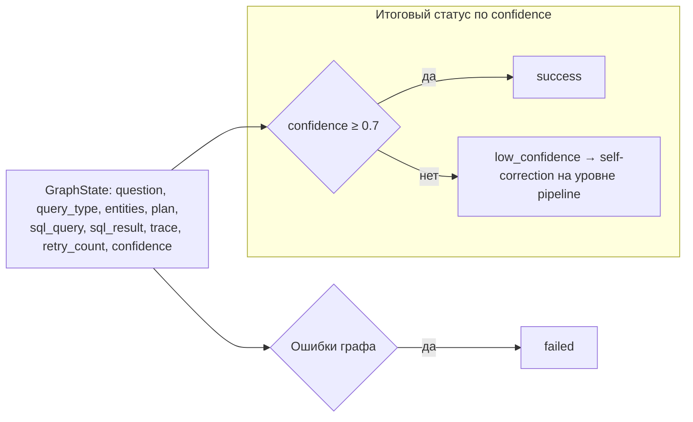

# Граф LLM-агента (LangGraph)

Узлы и маршрутизация из [`src/services/agent/graph.py`](../src/services/agent/graph.py)
и [`routing.py`](../src/services/agent/nodes/routing.py). Максимум ретраев на
каждый цикл коррекции — `MAX_RETRY_COUNT = 3`.

```mermaid
flowchart TD
    START([Вопрос пользователя via POST /ask]) --> C[classifier<br/>тип запроса + домен]

    C -- query_type = None --> F[failed]
    C -- ok --> D[disambiguation<br/>нужно ли уточнение]

    D --> P[planner<br/>план действий]

    P --> G[codegen<br/>генерация безопасного SQL]

    G -- SQL пуст / ошибки валидации, ретраев < 3 --> G
    G -- SQL пуст и ретраев = 3 --> F
    G -- валидация не пройдена, ретраев = 3 --> E
    G -- ок --> E[executor<br/>выполнение SELECT (read-only)]

    E -- sql_error, ретраев < 3 --> G
    E -- sql_error, ретраев = 3 --> F
    E -- ок --> V[verifier<br/>LLM-проверка SQL + результата]

    V -- needs_retry, ретраев < 3 --> G
    V -- needs_retry, ретраев = 3 --> A
    V -- ок --> A[answer<br/>формирование ответа]

    A --> ENDX([END])
    F --> ENDX
```

## Состояние и статус результата



## Объяснение узлов

| Узел | Что делает | Ключевая деталь |
|---|---|---|
| `classifier_node` | Тип запроса (`lookup`, `aggregate`, `cross_sheet`, `delta`, `sum_by_supplier`, `find_period`) и домен (`prices`/`metrics`/`generic`) | Структурированный вывод Pydantic |
| `disambiguation_node` | Проверка необходимости уточнения | `interrupt()` при необходимости |
| `planner_node` | Текстовый план действий | |
| `codegen_node` | Мастерит SQL: LLM или детерминированный `sql_compiler.compile_spec()` | Whitelist таблиц `mart.*`, только SELECT, баланс кавычек/скобок |
| `executor_node` | Выполняет SELECT, `statement_timeout` | Fallback-SQL при пустом результате |
| `verifier_node` | LLM-проверка корректности | Детерминированный fallback (conf = 0.75), если модель не вернула JSON |
| `answer_node` | Естественно-языковой ответ + chart-данные | Извлекает временной ряд из `sql_result` |

Кэш: `query_cache` (вопрос → SQL/результат) используется до построения графа.