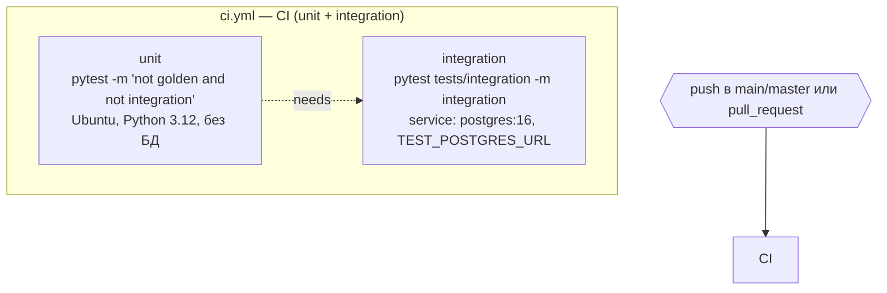
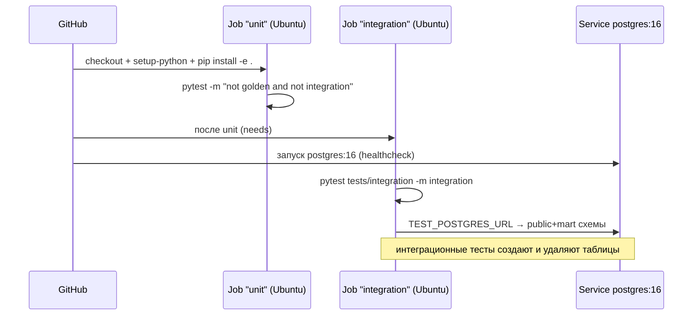

# CI / CD — GitHub Actions

Один workflow: [`ci.yml`](../.github/workflows/ci.yml) — юнит-тесты (без БД и LLM)
и интеграционные тесты с реальным PostgreSQL. Golden-тесты (LLM) в CI не запускаются.

## Детали

| Job | Команда | Требования |
|---|---|---|
| `unit` | `pytest tests/ -m "not golden and not integration" -v` | нет |
| `integration` | `pytest tests/integration/ -m integration -v` | `TEST_POSTGRES_URL` (service-контейнер) |

Локально: `pytest tests/` — юнит-тесты идут, integration пропускаются без
`TEST_POSTGRES_URL`, golden — без `--golden`.