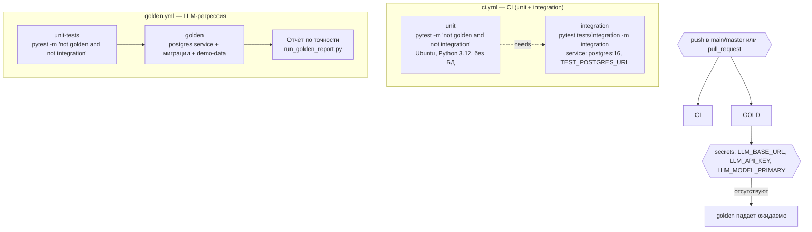
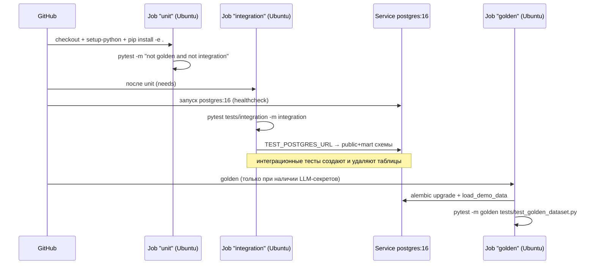

# CI / CD — GitHub Actions

Два workflow: [`ci.yml`](../.github/workflows/ci.yml) (без LLM) и
[`golden.yml`](../.github/workflows/golden.yml) (LLM-регрессия).

## Детали

| Job | Команда | Требования |
|---|---|---|
| `unit` | `pytest tests/ -m "not golden and not integration" -v` | нет |
| `integration` | `pytest tests/integration/ -m integration -v` | `TEST_POSTGRES_URL` (service-контейнер) |
| `unit-tests` (golden.yml) | `pytest tests/ -m "not golden and not integration" -v` | нет |
| `golden` | `alembic upgrade head` → `load_demo_data.py` → `pytest -m golden` | LLM-секреты |

Локально: `pytest tests/` — юнит-тесты идут, integration пропускаются без
`TEST_POSTGRES_URL`, golden — без `--golden`.