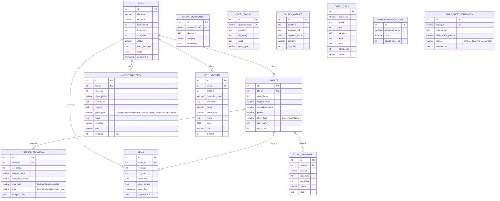

# Схема базы данных

Две схемы: **public** (сырые данные и служебные таблицы) и **mart** (нормализованная
витрина для SQL-агента). Булевы поля (`is_blank`, `sheet_kind_auto`, `is_active`)
хранятся как `INTEGER (0/1)`.

## Ключевые связи

- `files` → `sheets` (каскадное удаление), `sheets` → `column_metadata` / `cells` / `excel_comments`.
- `files` → `mart.price_facts` / `mart.metrics` по `file_id` (`ON DELETE CASCADE`).
- Агент напрямую читает только `mart.price_facts` и `mart.metrics` (whitelist в `sql_compiler`).
- `entity_dictionary` и `bm25_index.pkl` / `rapidfuzz` используются для разрешения сущностей до генерации SQL.