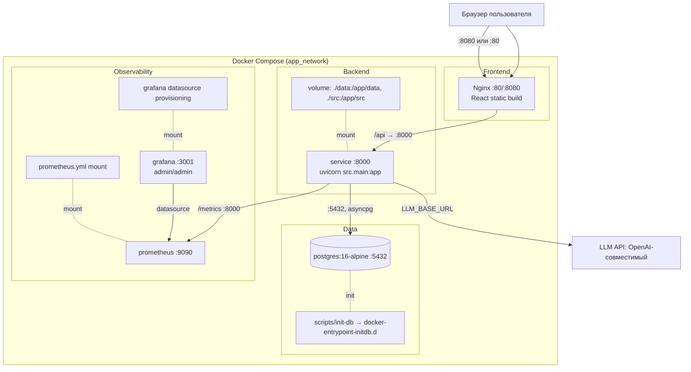

# Топология Docker Compose

Развёртывание через [`docker-compose.yml`](../docker-compose.yml). Backend
собирается из `Dockerfile`, frontend — из `Dockerfile.frontend` (Nginx static).



## Порты

| Сервис | Порт (host) | Назначение |
|---|---|---|
| `frontend` | 80 / 8080 | статика React + прокси на API |
| `service` | 8000 | FastAPI (`/docs` — Swagger, `/metrics`) |
| `postgres` | 5432 | PostgreSQL 16 |
| `prometheus` | 9090 | метрики |
| `grafana` | 3001 | дашборды (admin/admin) |

## Запуск

```bash
cp .env.example .env   # заполнить LLM_* и POSTGRES_*
docker compose up --build
```

Healthcheck `postgres` (pg_isready) — `service` стартует после готовности БД.