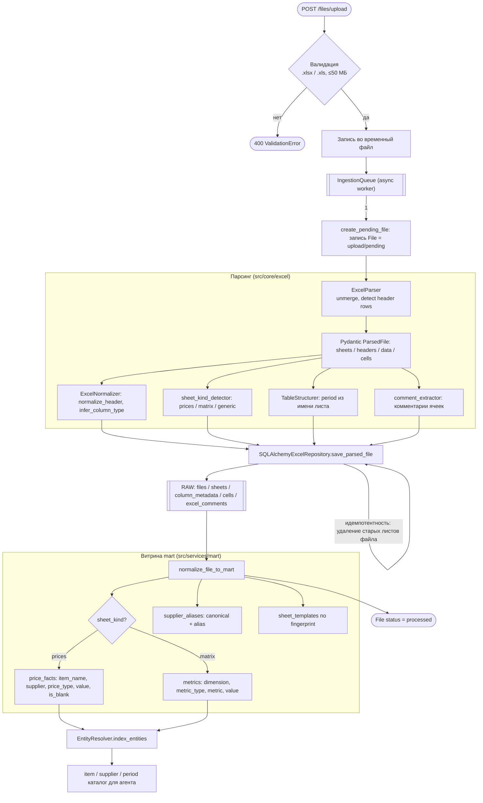

# Пайплайн загрузки и нормализации Excel

Путь файла от загрузки до витрины `mart`. Параллельные потоки: сырые таблицы
(`files`/`sheets`/`column_metadata`/`cells`) и нормализованные long-факты
(`mart.price_facts` / `mart.metrics`), плюс алиасы поставщиков и сущности.



## Последовательность инжеста

```mermaid
sequenceDiagram
    actor U as Пользователь
    participant API as FastAPI /files
    participant Q as IngestionQueue
    participant S as ExcelIngestionService
    participant R as Repository
    participant N as Mart Normalizer
    participant DB as PostgreSQL

    U->>API: upload .xlsx
    API->>Q: enqueue(path)
    Q->>S: create_pending_file
    S->>DB: insert files (pending)
    Q->>S: process_file
    S->>R: process_file
    R->>R: parse → save sheets/columns/cells (RAW)
    R-->>DB: insert files/sheets/column_metadata/cells
    S->>N: normalize_file_to_mart
    N->>N: удалить старые факты файла (идемпотентность)
    N-->>DB: insert mart.price_facts / metrics / supplier_aliases
    S->>R: index_entities
    R-->>DB: каталог сущностей (item/supplier/period)
    S-->>Q: status = processed
    Q-->>API: file_id + статус